# Changelog

All notable changes to Balanced Minecraft Hardcore. One list for every Minecraft version: each release ships the same changes for 1.20 to 26.1.

## [Unreleased]

Coming home after an exile now has a moment of its own, and BMH has an advancement tab.

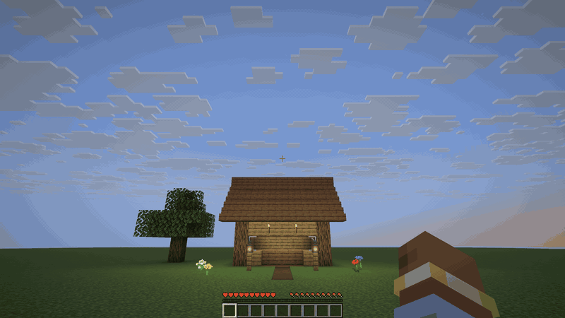

### Added

- When you get back home after a distant respawn, a title tells you how many blocks and nights you were away, and the bell rings. Home is your respawn bed or anchor, or the world spawn if you have none. A point of your Navigator's Amulet that you named before you died also counts. You must come within 24 blocks of it.
- BMH now has an advancement tab, Balanced Hardcore, with three branches: your journey after a death, the Eternal Items and the Navigator's Amulet. It shows the way from the Hollow Totem to the moon ritual. It gives no reward. One advancement stays hidden until you earn it.

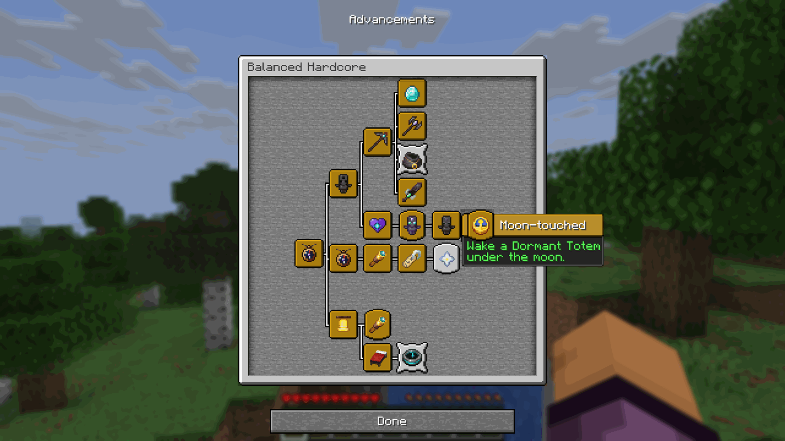

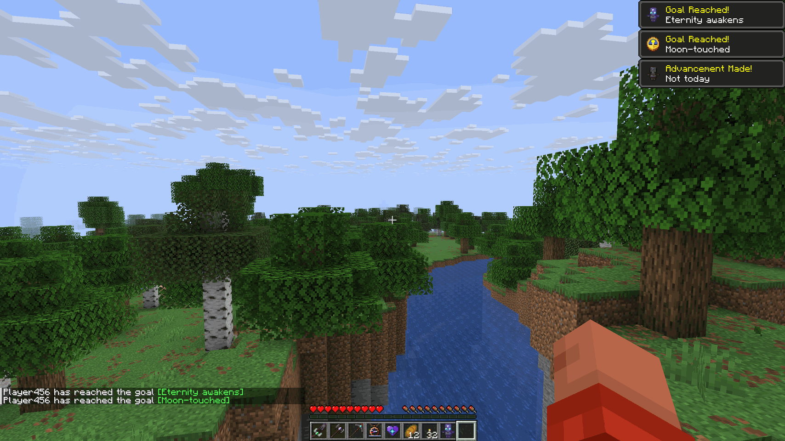

### Fixed

- A distant respawn no longer freezes the game while the new place generates. The server now prepares the place from the moment you die, and the journey screen waits until it is ready. This matters most in modpacks with a slow world generator, where the freeze could last almost a minute. If the place is not ready after 2 minutes, you respawn at your normal spawn point.

## [1.9.0] - 2026-11-07

The Totem of Eternity no longer starts over after it saves you. It falls asleep, stays with you, and the moon wakes it.

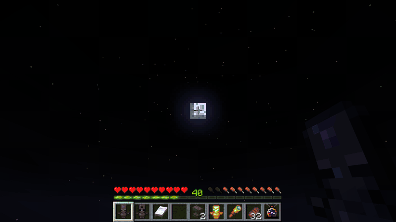

### Added

- After it saves you, the Totem of Eternity becomes a Dormant Totem of Eternal Life. It cannot save you, but it is an Eternal Item: it stays with you when you die.
- The moon ritual wakes a Dormant Totem. At night, under open sky, look at the moon and hold use. For 15 seconds the totem trembles, a chime climbs and your levels drain, 30 levels in all. Then your Totem of Eternity is back.
- The ritual must be done in one go. If you let go, look away, get hurt, lose the moon or run out of levels, the totem stays asleep and the levels already spent are gone.

### Changed

- The totem you craft is now the Hollow Totem of Eternal Life, with a new texture: empty eyes and an empty forehead socket. Your old Dormant Totems become Hollow Totems, with the same use.
- An Echo Heart at the anvil wakes only a Hollow Totem. A Dormant Totem wakes only under the moon.
- The README and the mod page now say that BMH must be installed on the server and on every client. A client without BMH is disconnected.

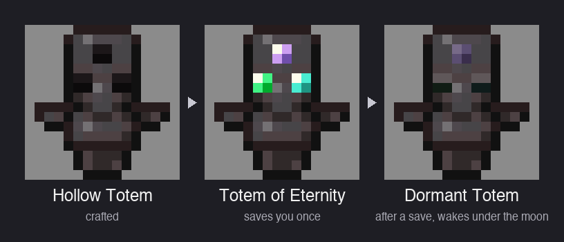

## [1.8.0] - 2026-11-06

BMH now runs on Minecraft 26.1, it has a config screen, and a star reading always shows the way back to the world spawn.

### Added

- A star reading now always draws a line toward the world spawn, the first place of your world. It has no name, and its line is a little lighter than the lines of your points. It works with no point at all, and it does not count toward the limit of points.
- Sneak and use the Navigator's Amulet anywhere that is not a bed or a lodestone: a list shows your points, with a Remove button on each. You can now remove a point whose bed or lodestone is gone.
- BMH now has a config screen. Open it from the Config button of BMH in the mods list (Forge, NeoForge) or in Mod Menu (Fabric). It changes the respawn distances and the number of points on the Navigator's Amulet. The screen changes the config file of your game, so it applies to your singleplayer worlds and to the worlds you open to LAN. A server still uses its own config file.
- BMH now runs on Minecraft 26.1 (Forge, Fabric and NeoForge).

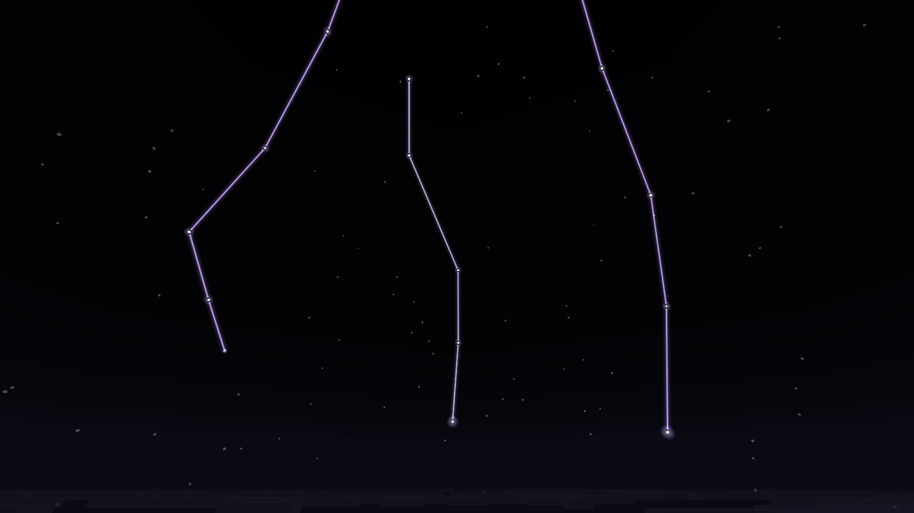

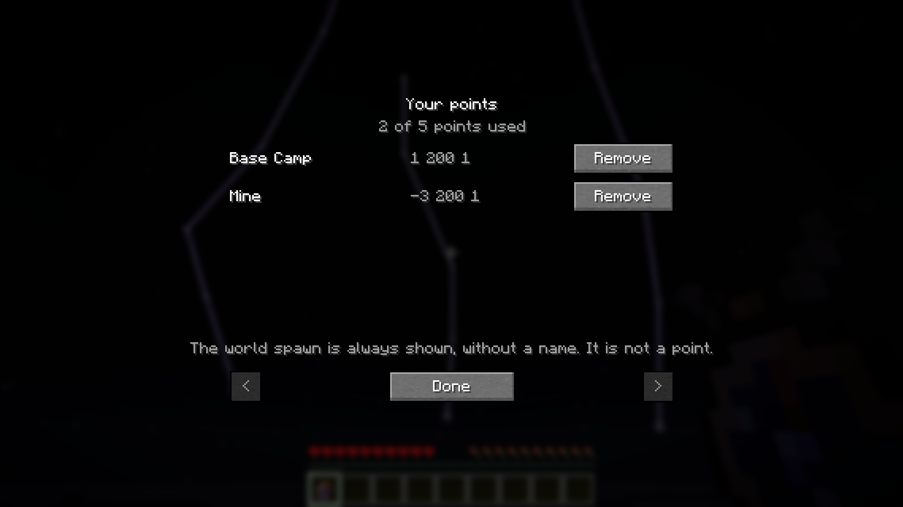

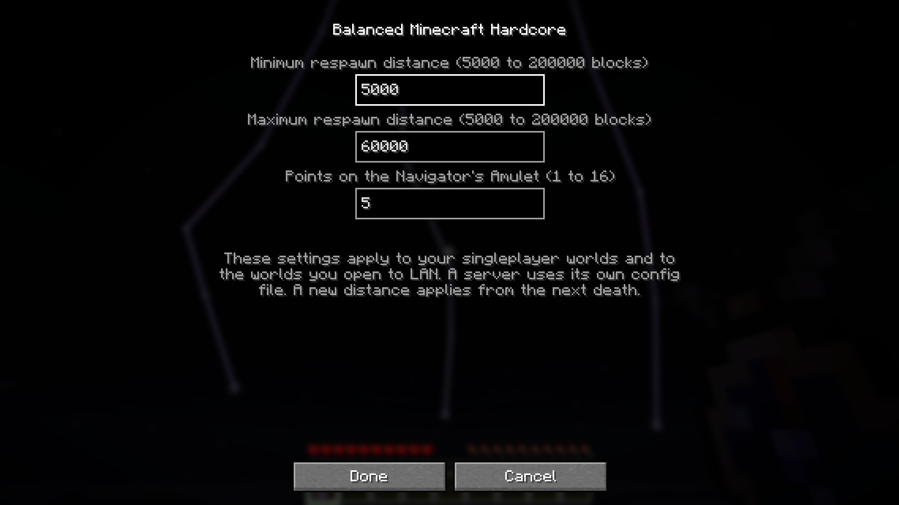

### Changed

- On Minecraft 26.1, the BMH game rules have new names, in the style of the 26.1 game rules: bmh:random_death_spawn_point, bmh:display_text_on_respawn, bmh:food_and_health_regen_on_wake_up, bmh:only_carry_one_eternal_item_type, bmh:damage_eternal_item_when_dead and bmh:remove_coordinates_in_survival. A world from an older Minecraft version keeps the values of these rules.
- On Minecraft 26.1, the Eternal Bundle shows its contents in the new vanilla bundle tooltip.
- On Minecraft 26.1, the Eternal Axe scrapes copper golems, like every axe.
- With no named point, a star reading no longer points to your respawn bed. It points to the world spawn.

### Fixed

- With some mods together (Easy Anvils and Stackables), the anvil kept the Eternal Item in the left slot after you took the result. You got a free copy. Now the item always leaves the left slot.

## [1.7.0] - 2026-11-05

The Navigator's Amulet now remembers several places, and the Totem of Eternity saves your life. Thank you to eternalsulfur, who reported the bugs and the ideas of this release (GitHub issue 5).

### Added

**Named points on the Navigator's Amulet**
- The amulet keeps up to 5 named points instead of one Home. The number is in the mod config (maxAmuletPoints, 1 to 16).
- Sneak and use the amulet on a bed or a lodestone: a screen asks for a name. On a bed or a lodestone that is already a point, the same screen lets you rename or remove it.
- A star reading draws one line of stars toward each of your points.
- Look at the last star of a line through a spyglass: the name of its point slowly appears.

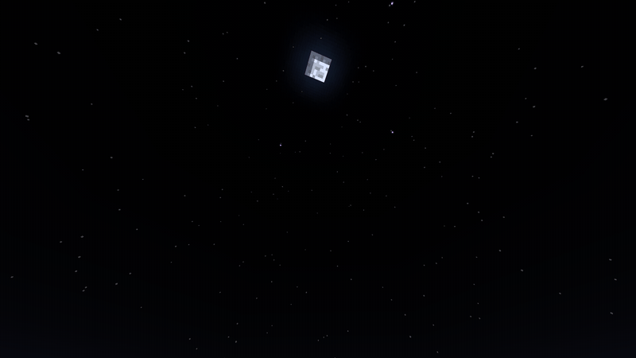

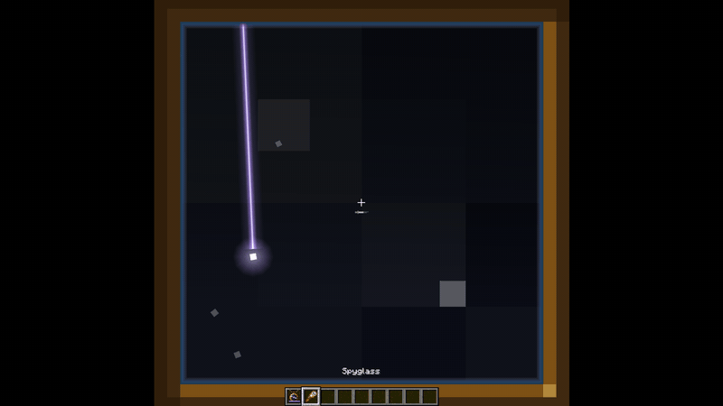

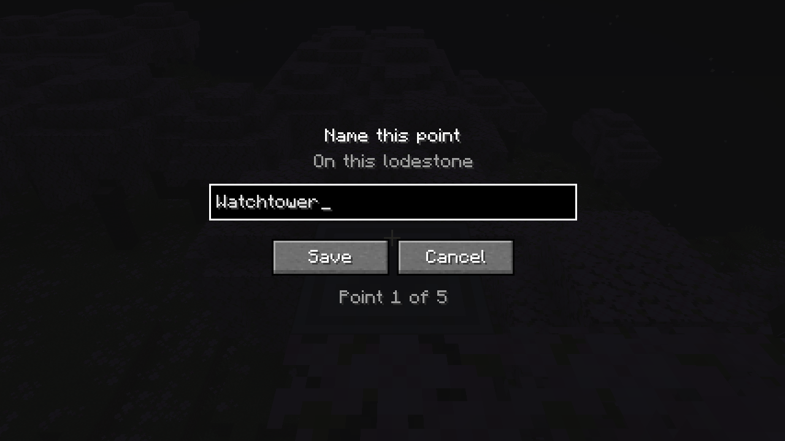

**The Totem of Eternity saves you**
- The Totem of Eternity now saves you from death once, from any slot of your inventory. It does not need to be in your hand. It gives Regeneration, Absorption and Fire Resistance, so it is stronger than a Totem of Undying. A Totem of Undying in your hand is used first.
- After it saves you, the totem turns back into a Dormant Totem. Awaken it again at an anvil with an Echo Heart.
- A chest, a shulker box, an ender chest or any other container holds one Totem of Eternity at most. A double chest counts as one container. Hoppers and droppers obey the same limit. Your inventory also holds one at most: a second totem falls to the ground.

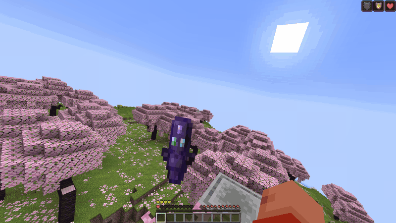

### Changed
- The Eternal Sword, Axe and Pickaxe no longer break. At their last point of durability, they are worn out. A worn-out tool deals half damage, mines at the speed of a stone tool and loses its ability. The tooltip of an Eternal tool now shows its durability, and says when it is worn out. Repair it to get its full power back.
- The Eternal Sword, Axe and Pickaxe have 33000 durability instead of 10000. A tool keeps the damage it already took, so it gets more durability left.
- A repair of the Eternal Sword, Axe or Pickaxe with gold blocks at an anvil always costs 15 levels. It does not make the next use of the anvil more expensive, so the anvil never says "Too Expensive" for it.
- The line of a star reading stays in the sky for 30 seconds, instead of 8.
- Your old Home becomes a point named Home. If you go back to an older version of the mod, you lose your points.
- Eternal Items on the ground no longer despawn. Explosions, cactus and other damage do not destroy them. Fire and lava already did not. The void still destroys them.
- The Eternal Sword has a new 16x16 picture in the inventory, on the ground and in item frames. Its pixels now have the same size as the pixels of other items. In your hands, the sword does not change.

### Fixed
- A second Eternal Sword, Axe, Pickaxe or Bundle no longer falls out of your inventory and comes back again and again. You cannot pick up a second copy of an Eternal Item while you carry one, as with the Totem of Eternity. The onlyCarryOneEternalItemType game rule controls this.
- The Totem of Eternity no longer has a blast furnace recipe. That recipe gave back the same totem after 50 minutes, and JEI showed it as the only way to make the totem. You make the totem at an anvil: put a Dormant Totem on the left and an Echo Heart on the right.

## [1.6.2] - 2026-11-05

### Changed
- The game music now fades out when you click Respawn on a distant respawn. It fades at the same time as the screen goes black. The bell and the other journey sounds do not change.
- The Haste and Resistance you get from a good sleep no longer show potion particles. The effect icons stay on the screen.
- The star reading of the Navigator's Amulet is twice as slow. The line takes more time to go from star to star.

## [1.6.1] - 2026-11-04

### Changed
- The Eternal Sword is bigger in your hands. Its texture had more pixels than other items, so it looked small. The blade is now a little shorter, and its pixels have the same size as the pixels of a vanilla sword.

### Fixed
- The Eternal Sword, Axe and Pickaxe look correct in your left hand. Before, they tilted and moved to the side, and were not mirrored.

## [1.6.0] - 2026-11-04

### Added
- A distant respawn now plays a short journey scene. The death screen fades to black, and a night sky comes in. A star lights up for your home. Then a line goes from star to star, like a star reading of the Navigator's Amulet, and the view follows it far away. An amethyst chime rings at each star. The message "A new journey begins for you" shows. At the last star, the sky breaks into pixel blocks over your new place, and the bell rings.

### Changed
- The respawn message now shows on a server too. Before, only the player of a singleplayer world or a LAN host saw it.
- After a distant respawn, you take no damage for 10 seconds while the scene plays. Vanilla gives 3 seconds.
- Only a distant respawn plays the bell and the message. In Adventure mode or when no safe place is found, the respawn is a normal one.

### Fixed
- A distant respawn no longer shows your bed or the world spawn for a moment before it takes you to the new place.
- When you turn off the `removeCoordinatesInSurvival` game rule, the full F3 screen with coordinates comes back at once. It also comes back when no player is in survival. Before, it stayed reduced until you set `reducedDebugInfo` to false.
- If you reload a world while the rule is on and then turn the rule off, the F3 screen stays reduced. Run `/gamerule reducedDebugInfo false` one time to fix it.

## [1.5.0] - 2026-11-04

### Added
- Dormant Totem of Eternal Life and Echo Heart. The Totem of Eternal Life is now made in steps: the old Totem of Eternal Life recipe makes a Dormant Totem, the Echo Heart is crafted from 4 crying obsidian, 4 echo shards and a nether star, and the two meet at an anvil (Dormant Totem on the left, Echo Heart on the right, 39 levels). The name field is ignored.
- The Totem of Eternal Life glows like an enchanted item and says "Eternity" in its tooltip. It is not a real enchantment, so a grindstone cannot remove it.
- Every Eternal Item now says in its tooltip that you wake farther while you carry it. The Eternal Sword, Axe and Pickaxe also say that each death costs them 7% durability, and each Eternal tool names its ability.
- Navigator's Amulet: sneak and use it on a bed or a lodestone in the Overworld to set your Home. Until you do, your Home is your respawn point (if it is in the Overworld), or the world spawn. Your Home stays with you through death.
- Navigator's Amulet: a star reading now draws a short constellation in the night sky, real stars linked from high overhead down to the horizon in the direction of Home. Only you see it; it fades after about ten seconds.
- Eternal Sword, Echo Strike: a full-strength hit that lands echoes a moment later onto the nearest other hostile mob within 5 blocks of the target, for half the damage, with a cyan line between the two. It never goes to players, villagers, animals, golems, armor stands or your own pets.
- Eternal Axe, smash: a hit landed while you fall hits harder the longer the fall, up to 3 times the damage after a fall of about 25 blocks, and the blow halves your fall distance, so you take about half the fall damage.
- Eternal Pickaxe, Echo Sense: breaking an ore makes the same ore within 8 blocks glow through walls for 5 seconds (stone and deepslate variants together, at most 64 at once).

### Changed
- The Totem of Undying no longer gives Fire Resistance when it saves you. You still get Regeneration and Absorption.
- The exile from a respawn anchor in the Nether is now as long, in world terms, as one from a bed in the Overworld. Before, it was eight times longer, because a Nether block counts for 8 Overworld blocks.
- On 1.21.1, mining a decorated pot with an Eternal Sword, Axe or Pickaxe now breaks it into sherds like with the other tools (it used to drop whole). Silk Touch still keeps it whole.
- The Eternal Sword, Axe and Pickaxe are now made at the smithing table: Totem of Eternal Life in the template slot, your netherite sword, axe or pickaxe, and an echo shard. The tool keeps its enchantments, name and wear. The dragon egg is no longer needed, and the old crafting table recipes are gone.
- New Eternal Bundle recipe: string, gold ingots, leather, netherite scrap and a Totem of Eternal Life. It no longer needs a vanilla bundle.
- Eternal tools are repaired with gold blocks at the anvil instead of a Totem of Eternal Life.
- The Eternal Bundle wears a small gold ring charm on its drawstring, empty or full.
- Navigator's Amulet, rebuilt: its needle now always points north, like a compass that cannot be fooled (Overworld only: it spins in the other dimensions). It has no durability any more, so it no longer takes Unbreaking.
- Navigator's Amulet: use it at night, under open sky and without rain, to read the stars. A reading shows your coordinates and costs one of its 3 starlight charges (the violet bar under the item). The charges come back at every nightfall, and a reading has a 2 second cooldown. Blindness, Darkness and having your eyes in water, lava or powder snow hide the stars too, and cost nothing.
- Navigator's Amulet: new recipe, string, 2 copper ingots, a compass and a spyglass.
- An amulet you already had keeps working as the new one. As soon as it sits in your inventory it drops its old wear and its Unbreaking (or Mending), which do nothing now that it has no durability.

### Fixed
- The Eternal Bundle now shows its filled texture when it holds items.
- On 1.21.1, the Eternal Sword, Axe and Pickaxe no longer refuse enchantments (Mending, Unbreaking and the rest of what their netherite versions take).
- The Navigator's Amulet coordinates now show on dedicated servers too.
- The BMH creative tab no longer shows a raw translation key as its name: it is called "BMH Tab".

## [1.4.0] - 2026-11-02

### Added
- NeoForge version for Minecraft 1.20.4 and 1.21.1. On 1.20.1, NeoForge runs the Forge version.

## [1.3.0] - 2026-11-01

### Added
- Minecraft 1.21.1, on Forge and Fabric (Fabric needs Fabric API).

### Known issues
- Moving a world from 1.20.x to 1.21.1: Eternal Bundles look empty afterwards. Empty them before you move the world.

## [1.2.0] - 2026-11-01

### Added
- Fabric version, for every Minecraft version from 1.20 to 1.20.4. It needs Fabric API. Its settings live in `config/bmh.properties`.

### Fixed
- The mod no longer stops a dedicated server from starting.
- On a LAN world, the Navigator's Amulet no longer shows a guest's coordinates on the host's screen. On-screen texts still only show in singleplayer and for the LAN host.

## [1.1.0] - 2026-11-01

### Added
- "Balanced Hardcore: ON/OFF" button on the Create New World screen (Game tab). Turning it off disables every BMH game rule for that world. It is greyed out in Hardcore mode.

### Fixed
- You no longer respawn in the middle of an ocean or a river.
- Coming back from the End no longer throws you thousands of blocks away from your bed.
- In multiplayer, each player now respawns at their own distance instead of the distance of whoever died last.
- You no longer respawn on the Nether roof, on top of leaves, or in water, lava or magma.
- The respawn distance now grows smoothly with difficulty and Eternal Items, instead of jumping straight to the maximum.
- Breaking your bed now removes your spawn point again, like in vanilla.
- The respawn bell and "new journey" message now play, and only when the distant respawn is on and you are not in Creative or Spectator.
- The Eternal Pouch no longer deletes Eternal Items.
- The Navigator's Amulet can be crafted again (its recipe failed to load).

## [1.0.0] - 2024-03-06

First release.
