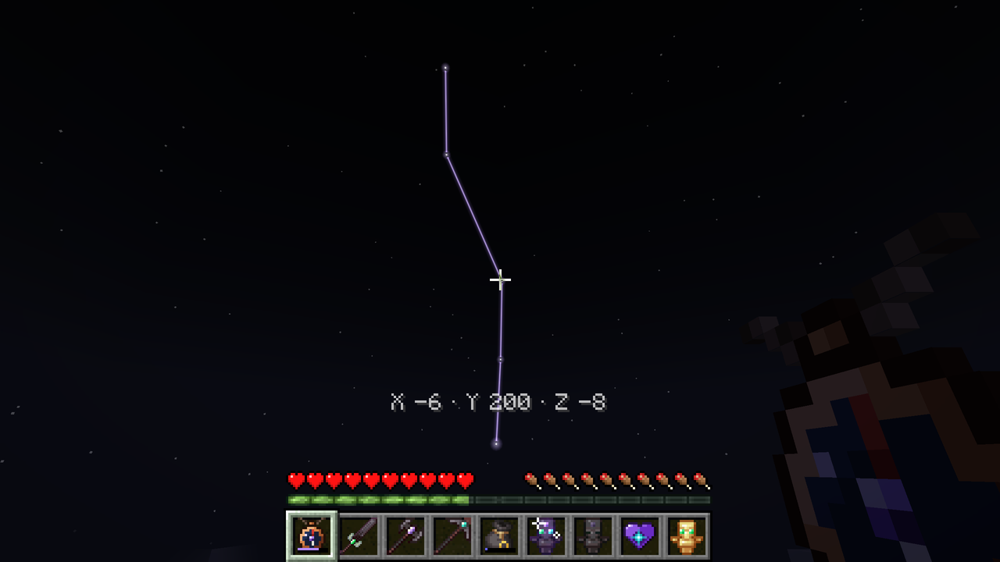

 </h1>
<h1 align="center">BALANCED MINECRAFT HARDCORE 1.20.4  
	
	
	
	
  
      
</h1>

Balanced Minecraft Hardcore (BMH) gives you flexibility in difficulty by replacing death by distant respawn based on your difficulty and **Eternal Items** possessed. BMH is the perfect middle ground between normal Minecraft gameplay and hardcore minecraft gameplay.
**Do not play on hardcore Minecraft, the mod work only on normal minecraft.**

## Features

### Dying Mechanic

Balanced Minecraft Hardcore (BMH) gives you flexibility in difficulty by replacing death by distant respawn based on your difficulty and Eternal Items possessed. The distance counts in world terms: a respawn anchor in the Nether sends you as far as a bed does in the Overworld, so 8 times fewer Nether blocks.

### Eternal Items

Eternal items stay with even after you die, but loose some durability when you die. They are very very powerful items and you can only carry one type at the time. Each one you carry also pushes your next respawn farther away.

On the ground, an Eternal Item never despawns, and explosions and cactus do not destroy it. The void still does.

### Totem of Undying

The Totem of Undying still saves you with Regeneration and Absorption, but it no longer gives Fire Resistance.

### Navigation

No coordinates, it means that you have to craft some special items to know where to go.

### Sleeping

Sleeping is now slightly revamped, it can give you buff if you sleep well.

## Items

### Eternal Items

#### Totem of Eternal Life

The heart of every Eternal Item, made in three steps:

1. Craft a **Dormant Totem of Eternal Life** (the old totem recipe).
2. Craft an **Echo Heart** from a nether star, echo shards and crying obsidian.
3. Awaken the totem at an anvil: Dormant Totem on the left, Echo Heart on the right, for 39 levels.

The awakened totem glows like an enchanted item. It is the smithing template of the Eternal tools and the core of the Eternal Bundle.

Carried anywhere in your inventory, the totem saves you from death once, like a Totem of Undying in your hand, and it also gives Fire Resistance. A Totem of Undying in your hand is used first. After it saves you, it turns back into a Dormant Totem: awaken it again with a new Echo Heart. You carry one at most, and a chest, a shulker box or any other container holds one at most.

  
  
  

#### Eternal Tools

Upgrade a netherite sword, axe or pickaxe at a smithing table: Totem of Eternal Life in the template slot, then the tool, then an echo shard. The tool keeps its enchantments, its name and its wear. Repair Eternal tools at an anvil with gold blocks. Each one has its own ability:

- **Eternal Sword, Echo Strike:** a full-strength hit echoes onto the nearest other hostile mob within 5 blocks, for half the damage.
- **Eternal Axe, Smash:** a hit while you fall lands harder the longer the fall, up to 3 times the damage, and the blow halves your fall damage.
- **Eternal Pickaxe, Echo Sense:** breaking an ore makes the same ore within 8 blocks glow through walls for 5 seconds.

  
  
  

#### Eternal Bundle

Just like the legacy Bundle but keep with you any item inside it even after you die.

  

### Normal Items

#### Navigator's Amulet

Your only way of knowing coordinates in your world, and a compass that only knows north: its needle always points north in the Overworld. Sneak and right click a bed or a lodestone to name a point there: you keep up to 5 points (mod config `maxAmuletPoints`), and the same click on a point lets you rename or remove it. At night, under open sky and without rain, right click to read the stars: your coordinates show on the action bar, a line of stars points toward each of your points for 30 seconds, and a spyglass on the last star of a line shows the name of its point. A reading costs one of its 3 starlight charges, which come back at every nightfall.

  

  

#### Bundle

Legacy minecraft bundle implementation.

  

## GameRules

- randomDeathSpawnPoint (default : true)
- displayTextOnRespawn (default : true)
- foodAndHealthRegenOnWakeUp (default : true)
- onlyCarryOneEternalItemType (default : true)
- damageEternalItemWhenDead (default : true)
- removeCoordinatesInSurvival (default : true)

## More Information

Most of the features are not actives when in creative mod.

## Loaders

Available for Forge and Fabric (Fabric needs [Fabric API](https://modrinth.com/mod/fabric-api)), from Minecraft 1.20 to 1.20.4, and 1.21.1. NeoForge: 1.20.1 (the Forge version), 1.20.4 and 1.21.1.
