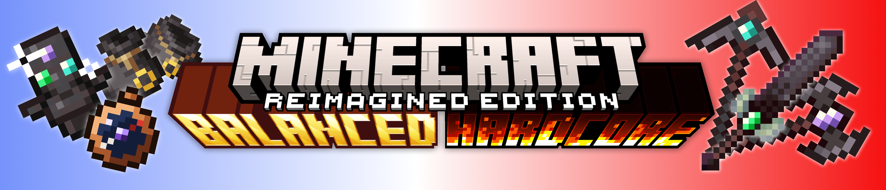

# Balanced Minecraft Hardcore

**Death is not the end of the run. It is the start of a long walk home.**

Balanced Minecraft Hardcore (BMH) sits between normal Minecraft and Hardcore. When you die, you do not lose the world: you wake up thousands of blocks from your bed, with only what you could protect. The harder the difficulty, and the more Eternal Items you carry, the farther you wake.

Play on a normal (non-Hardcore) world. Most features are off in Creative mode.

Available for **Forge**, **Fabric** (needs [Fabric API](https://www.curseforge.com/minecraft/mc-mods/fabric-api)) and **NeoForge**, on Minecraft 1.20 to 1.20.4 and 1.21.1.

---

## The distant respawn

When you die, you respawn far from your bed: from 5,000 to 60,000 blocks away (configurable), on a safe spot of solid ground. The distance grows with the difficulty and with each Eternal Item in your inventory. A respawn anchor in the Nether sends you as far, in world terms, as a bed in the Overworld.

A short journey scene plays on the way. The screen and the music fade to black, a night sky comes in, and a line of stars traces your path from home to your new place. Then the sky breaks into pixels over the new land, and a bell rings. You take no damage for 10 seconds after you arrive.

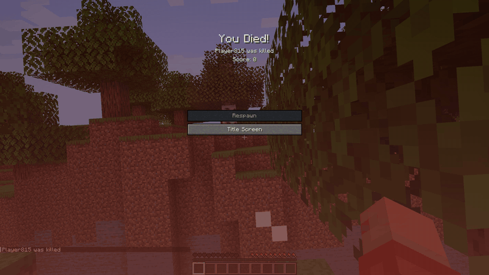

## No coordinates

The F3 screen hides your coordinates in Survival. To know where you are, and where home is, you need the Navigator's Amulet.

## The Navigator's Amulet

A copper compass that only knows north: its needle always points north in the Overworld.

- **Set your Home:** sneak and use it on a bed or a lodestone.
- **Read the stars:** at night, under open sky and without rain, use it. Your coordinates show on the action bar, and a line of real stars lights up in the sky, from overhead down to the horizon, in the direction of your Home.
- A reading costs one of its 3 starlight charges. The charges come back at every nightfall.

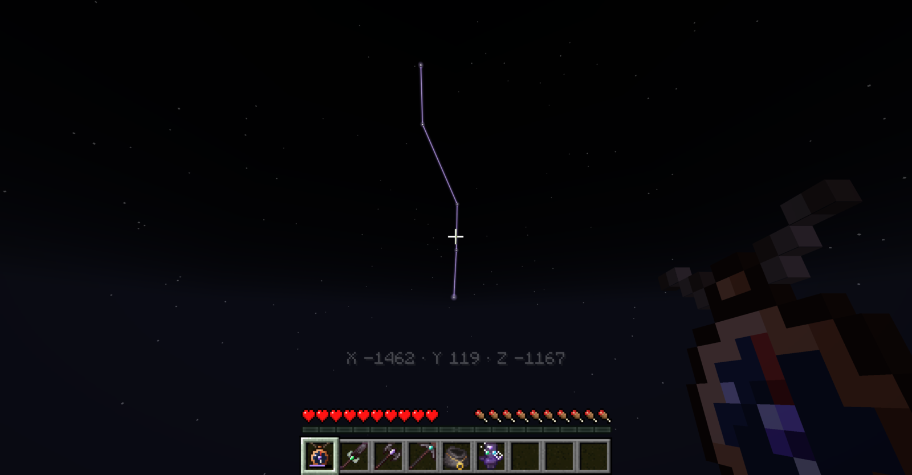

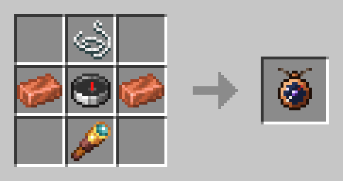

## Eternal Items

Eternal Items stay in your inventory when you die. Each death costs the Eternal tools 7% of their durability. They are very strong, so there is a price: you can carry only one type at a time, and each one you carry sends your next respawn farther away.

### Totem of Eternal Life

The heart of every Eternal Item, made in three steps:

1. Craft a **Dormant Totem of Eternal Life**.
2. Craft an **Echo Heart** from a nether star, echo shards and crying obsidian.
3. Awaken the totem at an anvil: Dormant Totem on the left, Echo Heart on the right, for 39 levels.

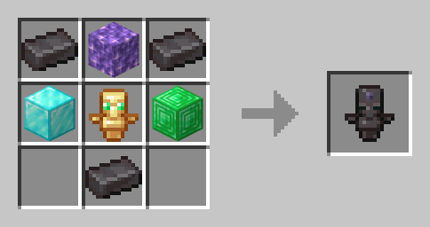 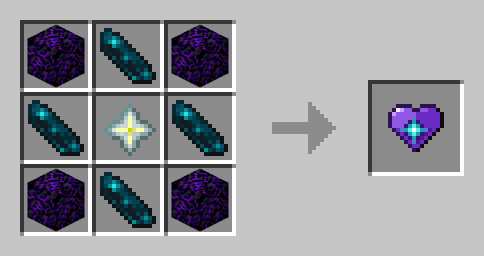 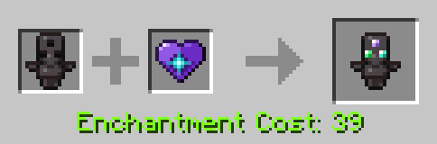

### Eternal tools

Upgrade a netherite sword, axe or pickaxe at a smithing table: Totem of Eternal Life in the template slot, then the tool, then an echo shard. The tool keeps its enchantments, its name and its wear. Repair it at an anvil with gold blocks. Each tool has its own ability:

- **Eternal Sword, Echo Strike:** a full-strength hit echoes onto the nearest other hostile mob within 5 blocks, for half the damage.
- **Eternal Axe, Smash:** a hit while you fall lands harder the longer the fall, up to 3 times the damage, and the blow halves your fall damage.
- **Eternal Pickaxe, Echo Sense:** breaking an ore makes the same ore within 8 blocks glow through walls for 5 seconds.

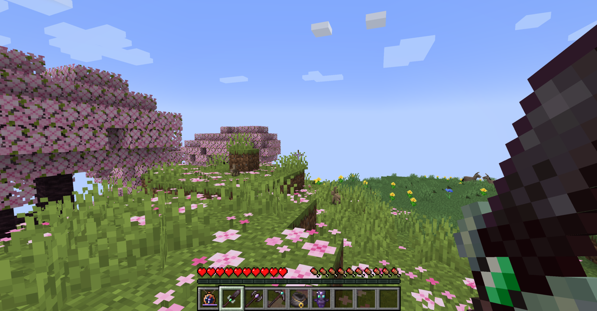

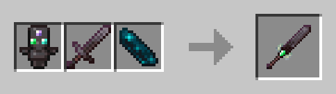 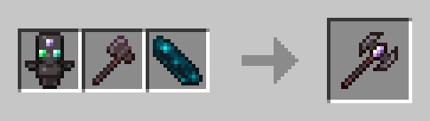 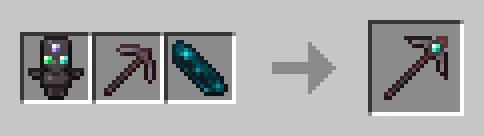

### Eternal Bundle

A bundle that keeps everything inside it when you die.

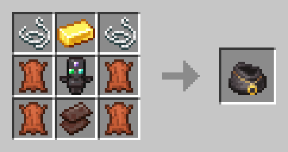

## Other changes

- **Sleeping:** waking up heals you and costs some food. If you go to bed well fed and at full health, you also wake with Haste II and Resistance II for 3 minutes.
- **Totem of Undying:** it still saves you with Regeneration and Absorption, but it no longer gives Fire Resistance.
- **Bundle:** the vanilla bundle, craftable on every version.

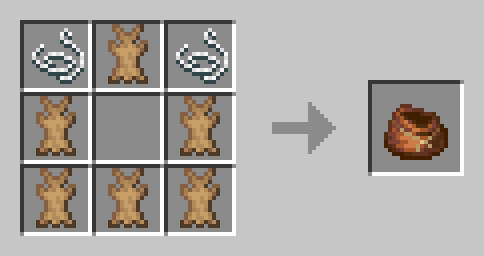

## Game rules

Every feature can be turned off with a game rule (all on by default). The "Balanced Hardcore" button on the Create New World screen turns them all on or off at once.

- `randomDeathSpawnPoint`
- `displayTextOnRespawn`
- `foodAndHealthRegenOnWakeUp`
- `onlyCarryOneEternalItemType`
- `damageEternalItemWhenDead`
- `removeCoordinatesInSurvival`

## Links

- Source code and full changelog: [GitHub](https://github.com/MrOrnithorynque/Balanced-Minecraft-Hardcore)
- Questions, ideas and bug reports: [Discord](https://discord.gg/Czn9JQxMjT)
